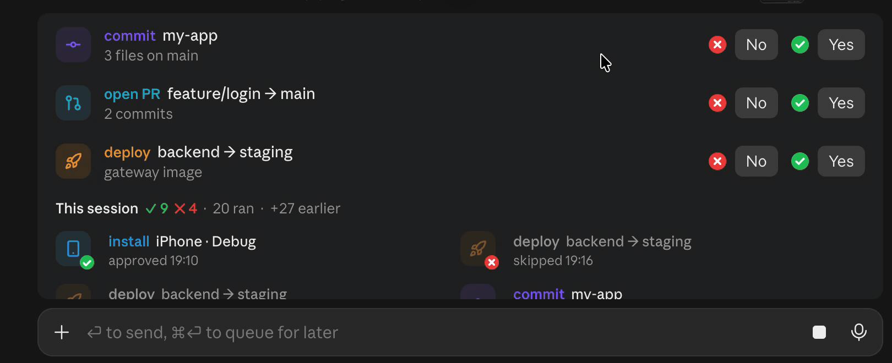
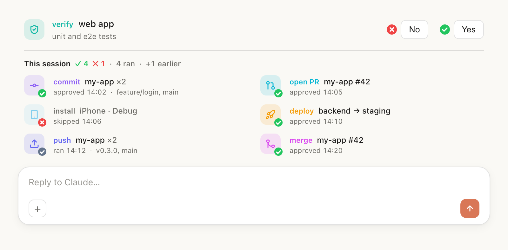
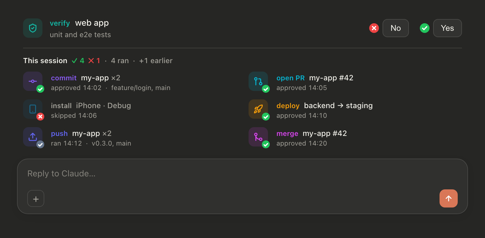

<h1 align="center">ship-band</h1>

<p align="center">A Claude Code mod that turns proposed actions into Yes/No buttons above the prompt.</p>

---

When Claude finishes work that needs a commit, a push, a pull request, a deploy, a release or an install on a phone, it proposes each step as a row above the prompt instead of asking in a paragraph. You answer with **✓ Yes** or **✕ No**, and every answer goes into a report of the session.

**In the Claude desktop app**: a real screen recording of ship-band 0.5, pressing No on a deploy, then Yes on a commit.



**Previews**, light and dark:

**Light**



**Dark**



<sub>Previews drawn from the mod's own icons and colours; buttons and the prompt box follow your Claude app's own style.</sub>

## What Yes and No do

ship-band is an **approval interface**, not a guard:

- **✓ Yes** sends "Yes, go ahead: commit my-app (3 files on main)" to Claude as your message, and Claude carries out the step.
- **✕ No** sends nothing. The step is recorded as skipped.
- In the desktop app, Yes and No are the app's own buttons, which ignore colour inside them, so a red ✕ and a green ✓ mark sit beside them. A terminal draws ✕ and ✓ inside the buttons instead.
- The tool's description asks Claude to wait for your Yes before running a step it proposed. The mod does not intercept or block commands: Claude can still run a command it never proposed, as it could without the mod. To enforce approval, use Claude Code's permission settings (allow and ask rules). Steps Claude runs without the panel still show up in the report, marked **ran**.

## The session report

Under the open steps, **This session** lists what happened, in two columns, one row per action:

| Badge | Status | Meaning |
| --- | --- | --- |
| green ✓ | approved | You pressed Yes. |
| red ✕ | skipped | You pressed No. The icon is faded. |
| grey ✓ | ran | Claude ran it without the panel (a successful `git commit`, `git push`, `gh pr create` or `merge`, `gh release create`, a publish, a deploy, a device install or a migration). |

Each action gets one row, however often it ran. Four commits across two folders show once, as **commit shop, my-app ×4**. The row shows the action in its mode's colour, its targets newest first, how many steps, the latest step's badge, status and time, and every branch or tag the steps landed on, newest first (**ran 17:52 · main, version2**). Rows follow their latest step, so the newest work sits last. To list every step on its own row instead, turn grouping off (see [Customize](#customize)).

The target is the folder the command ran in; for a PR, merge or release, gh's `--repo` names it. The branch comes from git's own output (`[main 1a2b3c4]`, `main -> main`), or from the command (`git push origin main`) when the output is cut off; a `git commit -q` takes the branch its command pushes. A rejected push names no branch.

The header counts every step, for example **This session ✓ 4 ✕ 1 · 4 ran · +1 earlier**. The newest 6 rows show; older rows are counted as **earlier**. Before anything happens, the band shows one quiet line, **This session · no steps yet**, so you can see the mod is loaded. A terminal, which draws no pictures, shows a coloured dot with ✓ or ✕ in place of each icon.

The report is kept per session. Reopen or resume a session and its report comes back: your answers are saved, and what Claude ran is rebuilt from that session's own transcript. Steps found only in the transcript have no time, because the transcript records none.

## Modes

| | Mode | Shown as | For |
| --- | --- | --- | --- |
|  | `commit` | commit | git commit |
|  | `push` | push | git push to a remote |
|  | `pr` | open PR | open a pull request |
|  | `merge` | merge | merge a branch or PR |
|  | `verify` | verify | run tests, lint, type checks or QA |
|  | `deploy` | deploy | deploy to an environment |
|  | `release` | release | tag a version, write release notes |
|  | `publish` | publish | publish to a store or registry |
|  | `device` | install | build and install on a phone or simulator |
|  | `migrate` | migrate | run a database migration |
|  | `run` | run | run a script, job or command |

`verify` and `run` are offered as rows but never auto-detected as **ran**: tests and scripts run too often.

## Customize

Ask Claude in plain words. Changes are saved and kept across sessions.

**Modes**, the rows and the report items:

- "Add a ship-band mode called translate, globe icon, pink, for updating locale files."
- "Rename the commit mode to save." / "Make deploy #ea580c."
- "Make deploy also match `./deploy.sh`, so the report counts it when Claude runs it."
- "Remove the translate mode." Removing a built-in you changed puts it back to its default.

Each mode has a **name** (lowercase letters, digits, `-`), a **label** (the word shown), an **icon**, a **colour** (`#rrggbb`), a **hint** that tells Claude when to use it, and an optional **match**: a regular expression for a shell command that does this step. A bad icon or colour falls back to a lightning bolt in slate grey; a bad match is ignored.

Icons: `commit`, `upload`, `pull-request`, `merge`, `shield-check`, `rocket`, `tag`, `package`, `smartphone`, `database`, `play`, `zap`, `globe`, `terminal`, `send`, `trash`, `refresh`.

**The report**:

- "Show 10 rows in the ship-band report." (2 to 12, default 6)
- "Use one column for the report." (1 or 2, default 2)
- "Turn off ship-band auto-detect." Only your Yes and No answers are reported then.
- "Show every step in the ship-band report." Turns grouping off: each commit or push gets its own row. Default on: one row per action.

## Install

At the prompt of a Claude Code terminal session:

```
/plugin install ship-band --marketplace Azzam/claude-ship-band
```

Answer `y` to add the marketplace, then pick a scope (user scope loads it in every session).

From a shell:

```bash
claude plugin install ship-band --marketplace Azzam/claude-ship-band
```

In the Claude desktop app, where `/plugin` does not run: click **+** next to the prompt box, then **Plugins**, **Add marketplace** with `Azzam/claude-ship-band`, then **Add plugin**. A mod installed from a terminal at the user scope also loads in the desktop app's local sessions.

Update with `claude plugin update ship-band@claude-ship-band`, then start a new session.

Requires a Claude Code build with mod (function hook) support; built and tested on 2.1.317. The mod API is early access and may change between releases.

## How it works

| Part | What it does |
| --- | --- |
| [`hooks/register.tsx`](hooks/register.tsx) | The hooks: the band, both tools, the Bash watcher, saving and rebuilding the report. |
| [`hooks/modes.ts`](hooks/modes.ts) | Built-in modes, the icon set, the badges, and the checks every saved mode passes before it is drawn. |
| [`hooks/detect.ts`](hooks/detect.ts) | Finds shipping steps in a shell command. Quoted text (commit messages, `echo`) never counts. |
| `offer_actions` tool | `mcp__ship-band__offer_actions`. Claude calls it with up to 6 rows: `kind` (a mode), a `title` naming only the target, a short `detail`. Each call replaces the open rows; the report stays. |
| `edit_modes` tool | `mcp__ship-band__edit_modes`. Claude calls it only when you ask to change modes or report settings. |
| Bash watcher | A `tool.call` hook on Bash: after a command succeeds, a shipping step it contains joins the report, with the branch or tag from its output, or completes the approved step of the same kind. |
| Band | A `ui.render` hook on `AbovePrompt` draws the open rows and the report, and gives way to surveys. |

## Data and privacy

- **Stored on your machine**, in the mod's own Claude Code store: your modes, the report settings, and each session's answers and detected steps, keyed by session id, for the newest 50 sessions.
- **Read on your machine**: the current session's transcript, when a session starts, to rebuild its report, and the output of each shell command Claude runs, for branch and tag names. Only the step, its target and its branch or tag are kept.
- **Never**: network calls, model calls, or running commands. Building the report costs no tokens. The only token cost is the `offer_actions` tool description, sent with each request like any tool's.

## Develop

```bash
claude --plugin-dir ./              # run a session with the mod loaded from this folder
claude plugin validate ./           # manifest, marketplace and hooks module
claude plugin test ./               # tests/band.test.tsx
```

## Credits

Icons from [Lucide](https://lucide.dev) (ISC) and [Feather](https://feathericons.com) (MIT). ship-band is a community mod, not an Anthropic product.

## License

[MIT](LICENSE) © 2026 Azzam
