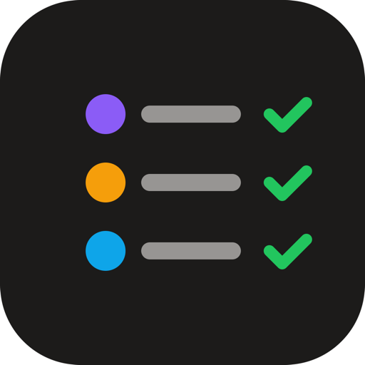

<p align="center"></p>

<h1 align="center">ship-band</h1>

<p align="center">A Claude Code mod: Claude asks before it commits, deploys or installs on a device,<br>and you answer from a band above the prompt with <b>✓ Yes</b> or <b>✕ No</b>.</p>

---

When Claude finishes work that leaves a step for you to approve, it puts each step in a row above the prompt instead of asking in a paragraph:

<p align="center">
  
  <br><sub>Light</sub>
</p>

<p align="center">
  
  <br><sub>Dark</sub>
</p>

<p align="center"><sub>Previews drawn from the mod's own icons and colours; buttons and the prompt box follow your Claude app's own style.</sub></p>

- **✓ Yes** sends "Yes, go ahead: commit my-app (3 files on main)" as your next message, and Claude runs that step.
- **✕ No** removes the row. Nothing runs.
- Nothing runs before you press Yes.

In the desktop app each row has a drawn icon on a tinted tile: violet for commit, amber for deploy, blue for install. A terminal draws a coloured mark in its place. Yes is always green and No always red.

## Install

At the prompt of a Claude Code terminal session:

```
/plugin install ship-band --marketplace Azzam/claude-ship-band
```

Answer `y` to add the marketplace, then pick a scope (user scope loads it in every session).

From a shell:

```bash
claude plugin install ship-band --marketplace Azzam/claude-ship-band
```

In the Claude desktop app, where `/plugin` does not run: click **+** next to the prompt box, then **Plugins**, **Add marketplace** with `Azzam/claude-ship-band`, then **Add plugin**. A mod installed from a terminal at the user scope also loads in the desktop app's local sessions.

Requires a Claude Code build with mod (function hook) support; this one was built and tested on 2.1.317. The mod API is early access and may change between releases.

## How it works

The mod is one hooks module, [`hooks/register.tsx`](hooks/register.tsx):

| Part | What it does |
| --- | --- |
| `offer_actions` tool | Registered for the model as `mcp__ship-band__offer_actions`. Its description tells Claude when to use it. Each call replaces the rows; an empty list clears them. |
| Row | `kind` (`commit`, `deploy` or `device`, shown as commit, deploy, install), a `title` naming only the target, and a short `detail`. Up to 6 rows. |
| Band | A `ui.render` hook on `AbovePrompt` draws the rows, and gives way to surveys and to an empty list. |
| Yes / No | Yes submits the step as your message; No removes it. Rows live in session state, so they survive a reload of the mod. |

The mod reads no files and runs no commands, and makes no network calls. Claude does the work itself, only after your Yes.

## Develop

```bash
claude --plugin-dir ./              # run a session with the mod loaded from this folder
claude plugin validate ./           # manifest, marketplace and hooks module
claude plugin test ./               # tests/band.test.tsx
```

## Credits

Icons from [Lucide](https://lucide.dev) (ISC). ship-band is a community mod, not an Anthropic product.

## License

[MIT](LICENSE) © 2026 Mohamed Azzam
